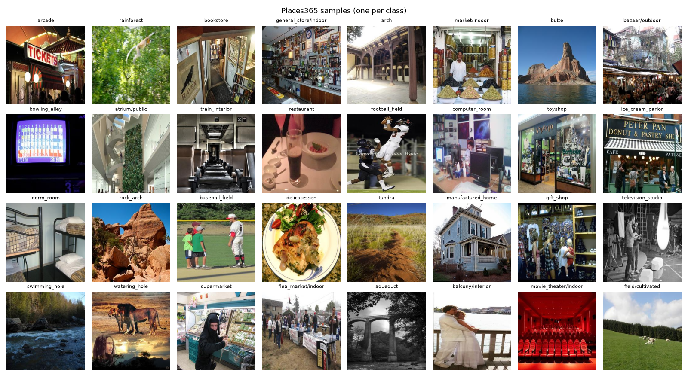
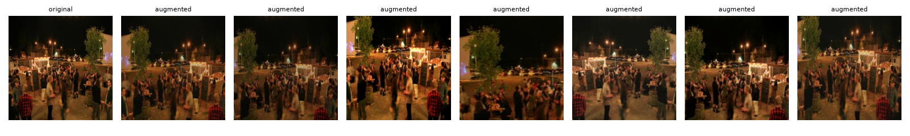
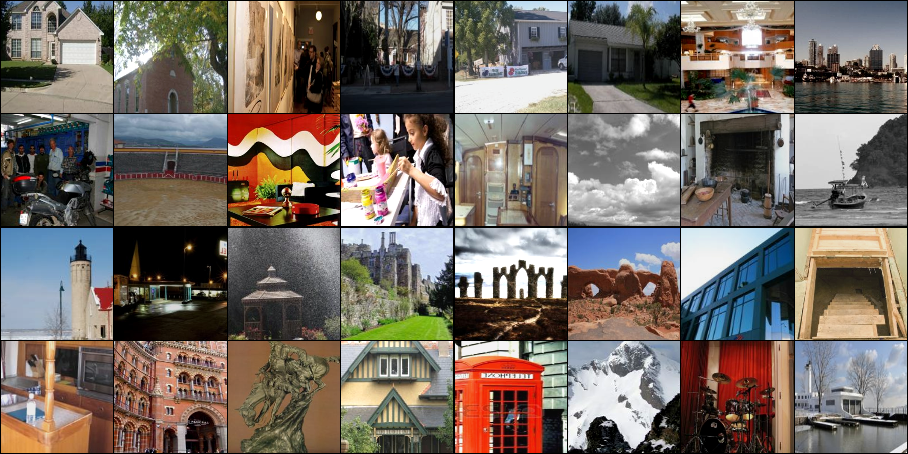
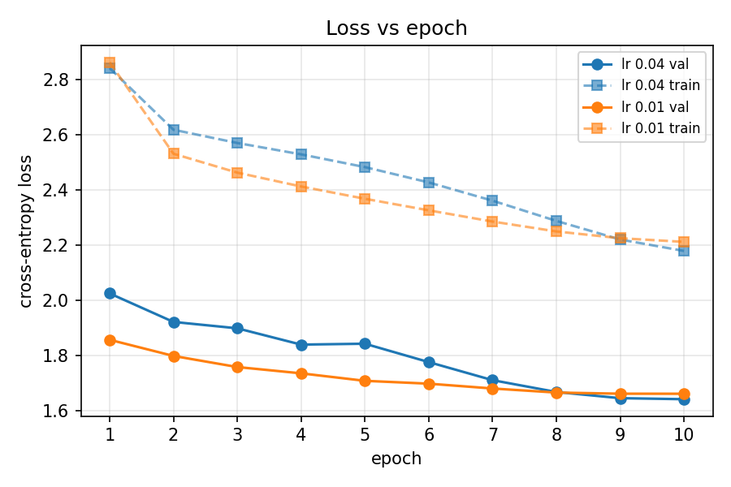
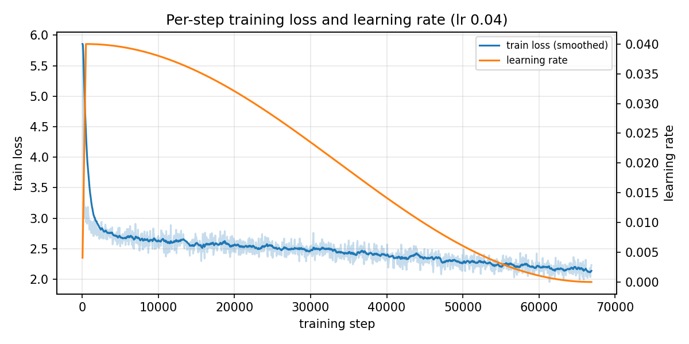
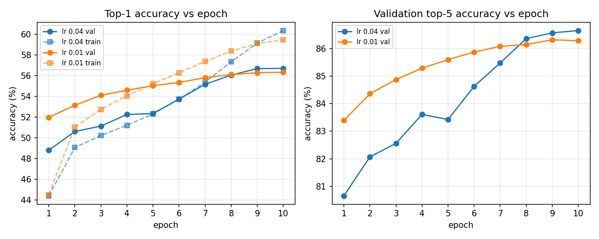
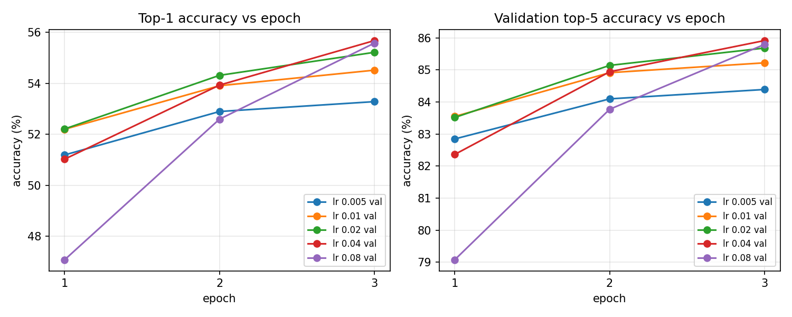

# Task 5 — Visualization (TensorBoard)

All four items the assignment asks for were logged to TensorBoard while the model trained (Task 4):

| Requirement | TensorBoard tab and tag | Logged by |
|---|---|---|
| Dataset images | Images: `dataset/samples`, `dataset/augmentations`, `train/augmented_batch` | `src/explore.py` (Task 2), `src/train.py` |
| Training loss vs epochs | Custom Scalars: "loss"; Scalars: `epoch/train_loss`, `epoch/val_loss` | `src/train.py` |
| Accuracy vs epochs | Custom Scalars: "accuracy"; Scalars: `epoch/train_top1`, `epoch/val_top1`, `epoch/val_top5` | `src/train.py` |
| Model graph | Graphs | `src/train.py` (`add_graph`) |

The figures below are the same data, exported with `src/plot_training.py` so they can go into the report. The runs shown are the final model (`r50_lr0.04`, learning rate 0.04) and the first 10-epoch run (`r50_1gpu`, learning rate 0.01).

## How to open TensorBoard

The logs are written on CARC to `/scratch1/$USER/runs/<run>/tensorboard`. They total about 27 MB, so the simplest way to view them is to copy them to a laptop:

1. On CARC, bundle every run's TensorBoard folder (event files only, no checkpoints):
   ```bash
   cd /scratch1/$USER/runs && find . -path '*/tensorboard/*' -type f | tar czf ~/tb_logs.tgz -T -
   ```
2. Download `~/tb_logs.tgz` from the JupyterLab file browser (right-click → Download).
3. Locally, unpack it into `runs/carc/` and run `tensorboard --logdir runs/carc`, then open http://localhost:6006.

Tips:
- In the left panel, filter runs with a regular expression, e.g. `r50` for the two 10-epoch runs or `lr_sweep` for the sweep.
- Set **Smoothing** to 0 for the per-epoch charts. Smoothing averages neighboring points, which is useful for the noisy per-step loss but distorts a 10-point curve.
- The **Custom Scalars** tab shows train and validation on the same chart. Older runs got this layout afterwards with `python src/plot_training.py --add-layout <run dirs>`. New runs get it automatically.

## 1. Dataset images



One random image from each of 32 random classes, with its label. Many classes differ in subtle ways: `market/indoor`, `general_store/indoor`, `supermarket` and `delicatessen` all show shelves of goods, and `bazaar/outdoor` and `flea_market/indoor` both show crowds and stalls. This is the class overlap described in Task 1, and it is why top-5 accuracy is much higher than top-1.



The same image after the training augmentation (Task 2): a random crop covering 35–100% of the image, resized to 224×224, a random horizontal flip, and random changes of up to 20% in brightness, contrast and saturation. Each epoch the model sees a different version of every image, which makes it harder to memorize the training set.



The first 32 images the model saw in the final run, exactly as they went into the network (after augmentation, with the normalization undone so they display correctly).

## 2. Loss vs epochs



- **Both losses fall every epoch** for both runs. The model is still learning at the end, and nothing suggests overfitting, which would show as validation loss rising while training loss keeps falling.
- **Training loss is above validation loss.** That seems backwards, but there are two reasons, and neither is a problem:
  - **Label smoothing (0.1).** The training target is 90% on the true class and the remaining 10% spread over the other 364 classes. Even a perfect model can't get below the entropy of that target, **0.91**, so the training loss carries a floor of about 0.9 that validation loss doesn't have. Validation loss is plain cross-entropy against the true label.
  - **Augmentation.** Training images are random crops, often of a small part of the scene, so they are harder than the center crops used for validation.
- **The lr 0.04 run starts worse and finishes better.** Its validation loss is above the lr 0.01 run through epoch 8, then drops below it (1.642 vs 1.661 at epoch 10). A large learning rate takes big, noisy steps. Once the cosine schedule has lowered the rate in the last few epochs, those steps settle into a better solution. The bump at epoch 5 (1.839 → 1.842) is the same noise.



The per-step view (logged every 50 steps; 66,880 steps in total) shows the start of training:
- The loss begins at **5.86**, almost exactly ln(365) = 5.90, the loss of guessing uniformly among 365 classes. The new final layer starts random, so this is expected.
- The loss drops below 3 by step 500, the end of the **warmup** (orange line ramping up), in less than 1% of training. The pretrained ImageNet features do most of the work; the new layer only has to learn how to map them to scene classes.
- After that, the loss falls slowly as the **cosine schedule** lowers the learning rate to zero.

## 3. Accuracy vs epochs



| Run | Val top-1, epoch 1 → 10 | Val top-5, epoch 10 | Train top-1, epoch 10 |
|---|---|---|---|
| lr 0.01 | 52.0% → 56.3% | 86.3% | 59.4% |
| **lr 0.04** | 48.8% → **56.7%** | **86.7%** | 60.3% |

- **Validation accuracy rises every epoch**, quickly at first and then flattening out. The lr 0.01 run gains only 0.2 points between epochs 8 and 10, so more epochs at the same settings would add little.
- **The lr 0.04 run overtakes the other in epoch 9.** This mirrors the loss chart.
- **Train accuracy crosses above validation accuracy** at epoch 5 (lr 0.01) or 7 (lr 0.04), and ends 3–4 points higher. A small gap like this is normal. With label smoothing and augmentation working against the training numbers, the gap is not a sign of overfitting.

**Learning-rate sweep** (Task 4, 3 epochs each, validation only):



The same pattern appears in every sweep run: the higher the learning rate, the worse epoch 1 is, and the more it catches up by epoch 3. At lr 0.08, epoch 1 is 4 points behind the others, but by epoch 3 it almost ties lr 0.04. The loss version is in `figures/task5/lr_sweep_loss.png`.

## 4. Model graph

The **Graphs** tab shows the network traced from one 224×224 input. It first appears as a single `ResNet` box between `input` and `output`. Double-click it to expand it into its parts:
- `conv1` → `bn1` → `relu` → `maxpool`: the **stem**, which shrinks the image from 224×224 to 56×56.
- `layer1`–`layer4`: four stages of **bottleneck blocks** (3, 4, 6 and 3 blocks). Each stage halves the spatial size and doubles the channels, ending at 7×7×2048. Expanding a block shows the residual connection: an `add` node where the block's input joins its output.
- `avgpool` → `fc`: global average pooling to a 2,048-value vector, then our new 365-class layer.

Use **Download PNG** in the left panel to save the graph for the report. The trace was taken in evaluation mode, so drawing it didn't change the BatchNorm statistics.

## Reproducing the figures

```bash
python src/plot_training.py --out docs/figures/task5 --name final \
    "lr 0.04=runs/carc/r50_lr0.04" "lr 0.01=runs/carc/r50_1gpu" "explore=runs/carc/explore"
python src/plot_training.py --out docs/figures/task5 --name lr_sweep --val-only \
    "lr 0.005=runs/carc/lr_sweep/lr0.005" "lr 0.01=runs/carc/lr_sweep/lr0.01" "lr 0.02=runs/carc/lr_sweep/lr0.02" \
    "lr 0.04=runs/carc/lr_sweep/lr0.04" "lr 0.08=runs/carc/lr_sweep/lr0.08"
```

The script writes the image files under their TensorBoard names (`explore_dataset_samples.png` and so on); the copies in `docs/figures/task5/` were renamed, and the duplicates removed.
