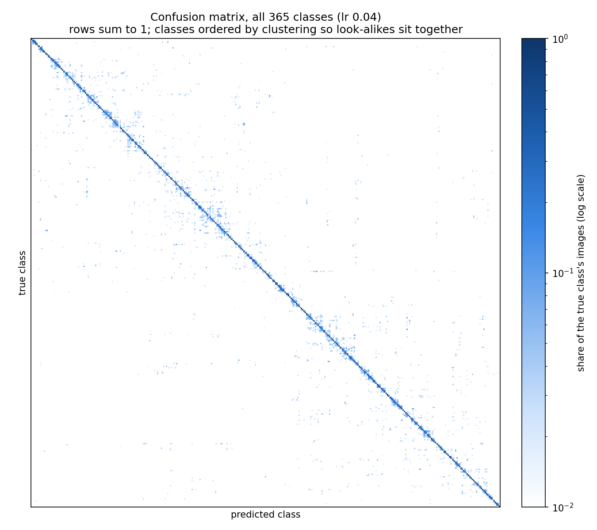
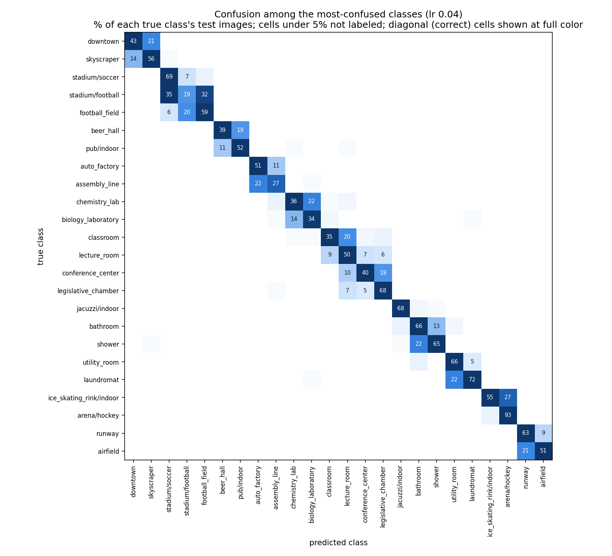
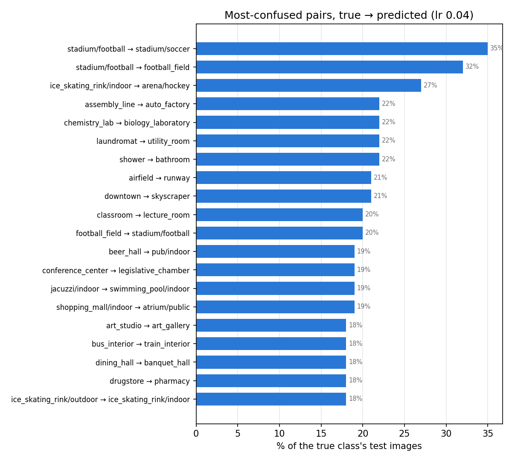
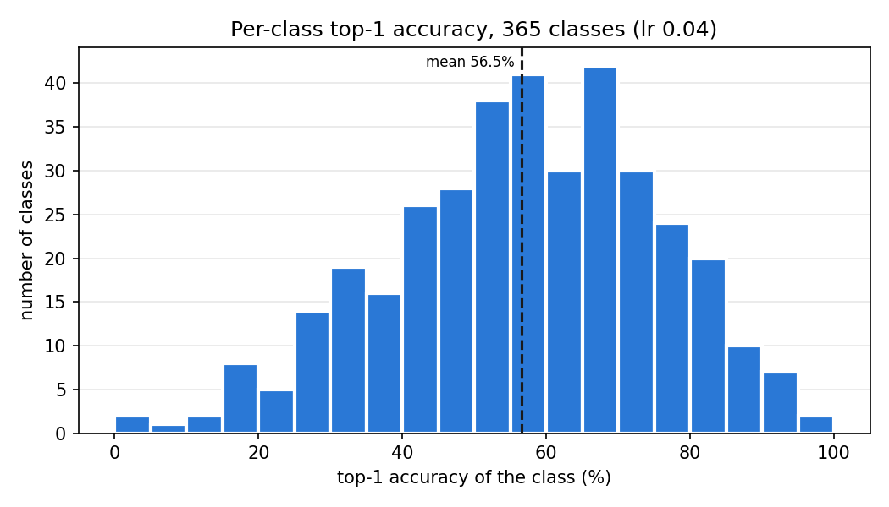
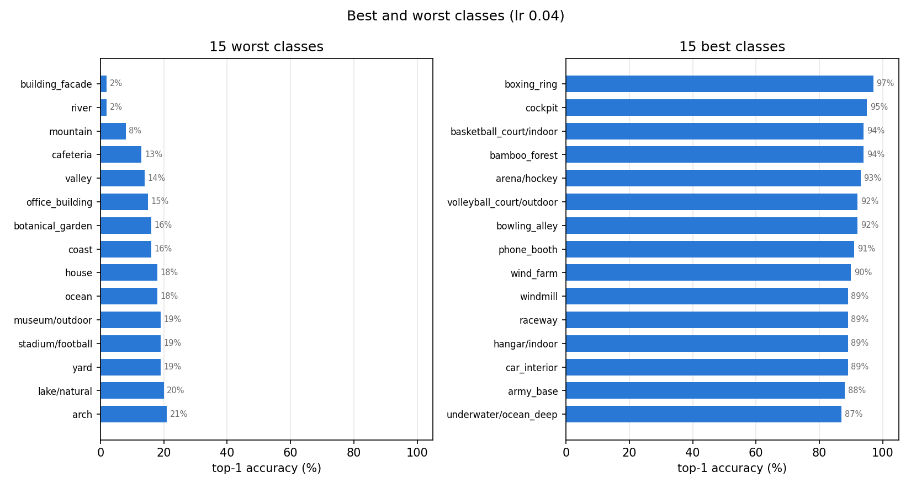
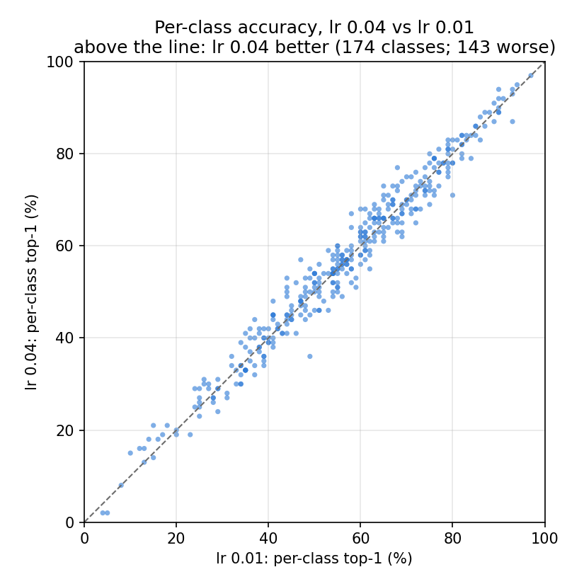

# Task 6 — Model Evaluation

## Result

On the **test set** (the official Places365 validation set: 36,500 images, 100 per class, never used for training or model selection), the final model reaches **56.54% top-1 / 86.58% top-5** with one center crop, and **57.18% / 87.07%** with 10-crop averaging.

| Model | Crops | Test top-1 | Test top-5 | Test loss | Our val top-1 (Task 4) |
|---|---|---|---|---|---|
| **ResNet-50, lr 0.04** (final, `r50_lr0.04`) | 1 | **56.54%** | **86.58%** | 1.642 | 56.70% |
| **ResNet-50, lr 0.04** (final, `r50_lr0.04`) | 10 | **57.18%** | **87.07%** | 1.622 | — |
| ResNet-50, lr 0.01 (`r50_1gpu`) | 1 | 56.21% | 86.32% | 1.661 | 56.32% |
| ResNet-152 fine-tuned, paper Table 2 | 10 | 54.74% | 85.08% | — | — |

- **Top-1 accuracy** is the share of images whose highest-scoring class is the correct one. **Top-5 accuracy** counts an image as correct if the right class is anywhere among the model's five highest-scoring guesses.
- **Single-crop vs 10-crop.** Single-crop scores one 224×224 crop from the center of each image, the same as during training. **10-crop** scores ten crops (the four corners and the center, plus a mirrored copy of each) and averages the ten predictions. The paper reports 10-crop, so the fair comparison is the second row against the last: **our ResNet-50 beats the paper's fine-tuned ResNet-152 by 2.4 points top-1 and 2.0 points top-5**, with a smaller network. The likely reasons are a stronger training recipe (label smoothing, cosine schedule, better ImageNet starting weights; Task 4), not the architecture.
- **Test agrees with validation.** Test top-1 (56.54%) is within 0.2 points of our held-out validation score (56.70%). We picked the learning rate using validation, so a small drop on fresh data is expected; one this small means the validation set was a reliable guide and we did not overfit to it.
- **10-crop adds 0.6 points**, less than the 1–2 we expected in Task 3, at 5.4× the cost (139 s vs 26 s on one V100). It helps 191 classes and hurts 110. The gain is real, not noise (a **McNemar test**, which compares two models on the same images by counting the images only one of them gets right, gives p = 2×10⁻⁸: 964 images fixed vs 733 broken).
- **lr 0.04 vs lr 0.01** is a small but real difference on the test set too: +0.33 points (1,794 images only lr 0.04 gets right vs 1,674 only lr 0.01 gets right; McNemar p = 0.04). The two models agree on 82% of their top-1 predictions and their per-class accuracies are almost identical (correlation 0.98; figure below), so they learned nearly the same thing.

Everything below is for the final model, single-crop, unless stated.

## How the evaluation works

1. `slurm/evaluate.sbatch` (1 V100, ~5 min of compute plus ~1 min to extract the data) runs `src/evaluate.py` three times: final model single-crop, final model 10-crop, and the lr 0.01 model single-crop.
2. `src/evaluate.py` loads `best.pt`, runs the test split, and saves every image's five highest-scoring classes, their probabilities, the probability given to the true class and the loss to `logs/task6/<name>.npz` (1.3 MB each). It also prints the summary metrics.
3. `src/plot_evaluation.py` runs on a laptop from those files and draws the figures in `docs/figures/task6/` plus `summary.md` (all the numbers in this write-up). It also logs the figures to TensorBoard (`runs/carc/eval`, **Images** tab).

The metric code is in `src/metrics.py`, with tests in `tests/` on small hand-checked examples (`python -m pytest tests`).

## 1. The confusion matrix

A **confusion matrix** has one row per true class and one column per predicted class. Cell (row *t*, column *p*) counts the test images of class *t* that the model labeled *p*. Correct predictions sit on the **diagonal**; every off-diagonal cell is a specific mistake. We **row-normalize** it (divide each row by its 100 images), so a cell reads as "the share of class *t*'s images that went to *p*".



At 365×365 the class names can't be printed, so this figure shows the structure:
- **Classes are reordered by hierarchical clustering**, an algorithm that repeatedly merges the two classes (or groups) the model mixes up most. Classes it confuses with each other end up next to each other, so groups of look-alike scenes show up as small **blocks along the diagonal**. In alphabetical order the same mistakes would be scattered across the whole matrix.
- **The color scale is logarithmic.** The diagonal is around 0.5 and most mistakes are 0.01–0.2, so on a linear scale everything off the diagonal would look white. White cells mean the model never made that mistake.
- **Most mistakes stay inside a block.** The space far from the diagonal is almost empty: when the model is wrong, it is usually wrong in a sensible way, picking a closely related scene. This matches the **top-5** result: for **69% of the images it gets wrong, the correct class is still among its top 5 guesses**.



The readable version: the 24 classes involved in the most frequent mistakes, ordered by the same clustering so each confused group is together. Numbers are the % of the row's test images. (The color scale tops out at the largest mistake, so the correct-answer diagonal cells are all dark.) The groups are pairs or triples of scenes that differ mainly in a detail or in how the photographer framed them:
- **Sports venues:** `stadium/football` is right only 19% of the time; 35% go to `stadium/soccer` and 32% to `football_field`. A stadium photo is mostly a green field with lines, and the stands can be out of frame. `ice_skating_rink/indoor` → `arena/hockey` (27%) is the same problem: a hockey arena *is* an indoor ice rink.
- **Rooms with the same furniture:** `classroom` ↔ `lecture_room`, `conference_center` → `legislative_chamber` (rows of seats facing a front), `chemistry_lab` ↔ `biology_laboratory` (benches and glassware), `shower` ↔ `bathroom`, `laundromat` → `utility_room` (washing machines).
- **The part vs the whole:** `airfield` → `runway`, `downtown` → `skyscraper`, `assembly_line` → `auto_factory`. One class is a wider view of the other, so a single photo can honestly be both.

Many of these are mistakes a person could make too, and some are arguably label noise: the dataset assigns each photo one label even when two fit. This is the class overlap predicted in Task 1, and it is why top-5 accuracy (87%) is 30 points above top-1.



The 20 largest single mistakes, as bars. The arrow reads "true class → what the model said". Note the direction matters: 32% of `stadium/football` images become `football_field`, and 20% go the other way.

## 2. Per-class accuracy

**Per-class accuracy** is the top-1 accuracy of each class on its own (the diagonal of the row-normalized matrix). Task 1 and Task 2 noted the training set is mildly imbalanced and said we'd check whether some classes are left behind.



- The 365 classes range from **2% to 97%**, with a median of 57% and a standard deviation of 19 points. The overall accuracy hides a wide spread.
- 32 classes are below 30% and 36 are above 80%.
- With 100 test images per class, each class's accuracy is only measured to about ±5 points (one **standard error**: the typical size of the random error from having only 100 images). Differences of a few points between two classes don't mean much; differences of 30 points do.
- The test set has exactly 100 images per class, so the **mean per-class accuracy equals the overall accuracy** (56.54%). The model is not doing well overall by doing well on large classes only.



**The best classes** have a distinctive object or layout that appears in almost every photo: `boxing_ring` (97%), `cockpit` (95%), `basketball_court/indoor`, `bamboo_forest`, `arena/hockey`, `bowling_alley`, `phone_booth`, `wind_farm`.

**The worst classes** are mostly broad, generic scenes that overlap with many more specific classes. Their mistakes are spread thinly over many neighbors, so they don't appear in the most-confused pairs above:

| Class | Top-1 | Top-5 | Where its images go (top 4, out of 100) |
|---|---|---|---|
| `river` | 2% | 61% | `swimming_hole` 14, `bridge` 8, `canal/urban` 6, `lake/natural` 5 |
| `building_facade` | 2% | 51% | `apartment_building/outdoor` 10, `courthouse` 7, `synagogue/outdoor` 6, `embassy` 6 |
| `mountain` | 8% | 77% | `canyon` 12, `volcano` 11, `mountain_snowy` 10, `butte` 8 |
| `cafeteria` | 13% | 61% | `dining_hall` 13, `food_court` 10, `restaurant` 8, `beer_hall` 7 |
| `valley` | 14% | 63% | `mountain_path` 7, `tundra` 7, `desert/vegetation` 5, `mountain` 5 |
| `coast` | 16% | 77% | `beach` 9, `cliff` 9, `lagoon` 7, `pier` 5 |
| `ocean` | 18% | 78% | `beach` 11, `wave` 10, `cliff` 9, `coast` 8 |

A photo of a mountain with snow is also `mountain_snowy`; a building front is also a courthouse or an embassy. The model has learned to prefer the more specific label, and it rarely predicts the generic one at all: it says `river` only 17 times on the whole test set (the test set has 100 of each, and the average class is predicted 100 times), `mountain` 40 times and `building_facade` 41 times. The correct class is still in the top 5 for half to three-quarters of these images.

The worst classes are not the small classes from Task 2's imbalance check. They are the generic ones, so imbalance is not what limits accuracy, and resampling or loss weighting (deliberately not done in Task 2) would not fix them.

## 3. Confidence

The model's probability for its top guess is a useful signal of whether to trust it:

| Top-guess probability | Images | Actual accuracy |
|---|---|---|
| under 0.2 | 2,984 | 18% |
| 0.2–0.4 | 10,187 | 34% |
| 0.4–0.6 | 8,922 | 54% |
| 0.6–0.8 | 7,422 | 74% |
| 0.8 and up | 6,985 | 91% |

Accuracy rises steadily with confidence, and each bin's accuracy is close to its probability range. The model is roughly **calibrated**: when it says 70%, it is right about 70% of the time. Label smoothing (Task 4) discourages overconfident outputs and is known to help with this, though we didn't train a model without it to check.

## 4. Comparing the two learning rates



Each dot is one class. Dots above the dashed line are classes the lr 0.04 model gets more right. The cloud hugs the line: 174 classes improve, 143 get worse and 48 are unchanged, and most moves are within the ±5-point noise of a 100-image class. The two learning rates produce models with the same strengths and weaknesses; lr 0.04 is slightly better across the board rather than much better on some classes.

## Limitations

- **One label per image.** Many test photos legitimately fit two classes (Section 1). Top-1 accuracy counts those as wrong, which understates how useful the model is; top-5 is the better measure of "understands the scene".
- **100 images per class** limits how precisely each class's accuracy is known (±5 points). Overall numbers are precise (±0.26 points).
- **Mixed precision.** Inference ran in fp16 (AMP), like training and like the validation numbers in Task 4. We did not rerun in fp32 to compare.

## Reproducing

On CARC, from `~/places_image_classification`:

```bash
mkdir -p logs && SBATCH_EXCLUDE=d13-02,d14-09 sbatch slurm/evaluate.sbatch
tar czf ~/task6_eval.tgz -C logs task6
```

Download `~/task6_eval.tgz` into the repo's `logs/` folder, unpack it there (`tar xzf logs/task6_eval.tgz -C logs`), then locally:

```bash
python src/plot_evaluation.py --out docs/figures/task6 --tensorboard runs/carc/eval \
    "lr 0.04=logs/task6/r50_lr0.04.npz" "lr 0.04, 10-crop=logs/task6/r50_lr0.04_10crop.npz" \
    "lr 0.01=logs/task6/r50_1gpu.npz"
```

The first run listed is the one plotted in detail; every run goes into the table in `docs/figures/task6/summary.md`. The extra statistics in Sections 2–4 (where the worst classes' images go, calibration, McNemar tests) were computed from the same `.npz` files with a few lines of numpy.
