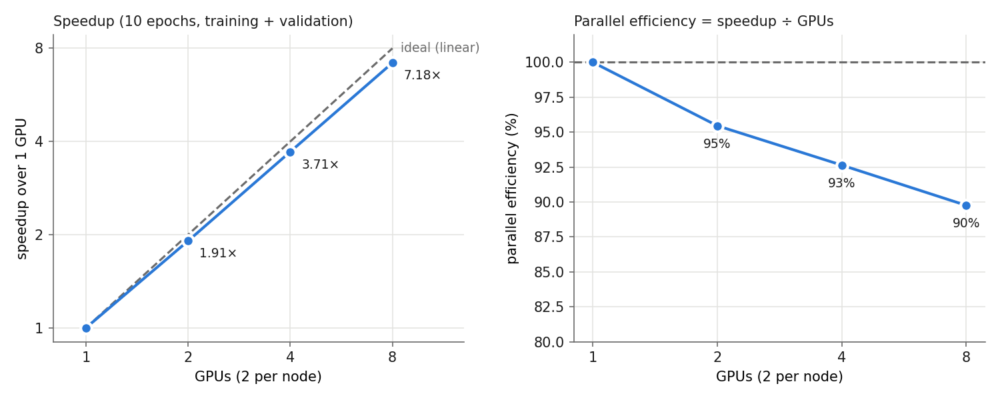
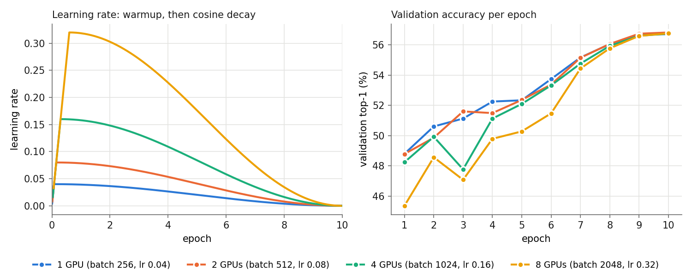
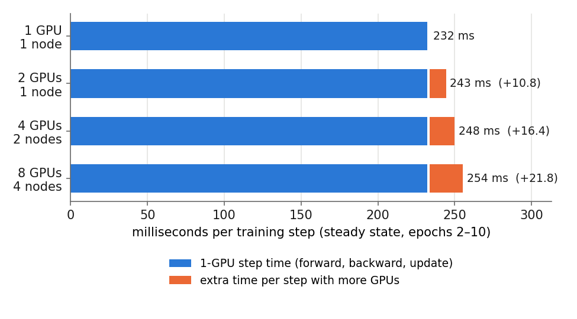

# Task 8 — Scaling Analysis (1, 2, 4 and 8 GPUs)

## Result

We trained the same ResNet-50 for the same 10 epochs on 1, 2, 4 and 8 V100 GPUs. **8 GPUs finished in 37 minutes instead of 4 h 25 min: a 7.2× speedup at 90% parallel efficiency.** Final accuracy didn't change: every configuration ended within 0.11 points of 56.7% top-1, well inside the measurement noise.



| GPUs | Nodes | Global batch | Peak lr | Steps per epoch | Throughput (img/s) | Training | Validation | **Total** | **Speedup** | **Efficiency** | Val top-1 | Val top-5 |
|---|---|---|---|---|---|---|---|---|---|---|---|---|
| 1 | 1 | 256 | 0.04 | 6,692 | 1,103 | 259.3 min | 6.2 min* | **265.5 min** | **1.00×** | **100%** | 56.70% | 86.65% |
| 2 | 1 | 512 | 0.08 | 3,346 | 2,109 | 136.0 min | 3.0 min | **139.1 min** | **1.91×** | **95.5%** | 56.81% | 86.59% |
| 4 | 2 | 1,024 | 0.16 | 1,673 | 4,122 | 70.0 min | 1.7 min | **71.6 min** | **3.71×** | **92.6%** | 56.73% | 86.73% |
| 8 | 4 | 2,048 | 0.32 | 836 | 8,070 | 36.0 min | 0.9 min | **37.0 min** | **7.18×** | **89.8%** | 56.75% | 86.67% |

- **Throughput** is training images per second, averaged over epochs 2–10 (epoch 1 is slower for every configuration; see below).
- **Total** is the time spent training and validating over all 10 epochs. **Speedup** is the 1-GPU total divided by this total. **Parallel efficiency** is speedup ÷ GPUs: 100% would mean each added GPU contributes as much as the first.
- *The 1-GPU run predates our timing log, so its validation time is estimated from the gaps between its epoch timestamps (37 s per epoch); its two interrupted epochs are excluded (Task 7). Validation is under 3% of the total in every configuration, so this estimate barely affects the speedups.
- Val top-1/top-5 are on our 90,000-image validation split, single center crop, from the last epoch (which was also the best in every run).

The runs are `r50_lr0.04` (1 GPU, from Task 4), `r50_ddp_1n2g`, `r50_ddp_2n4g` and `r50_ddp_4n8g`. The multi-GPU runs used `slurm/train_ddp.sbatch` (Task 7) in the course's node reservation. The table and figures come from `src/plot_scaling.py`:

```bash
cd src && python plot_scaling.py --out ../docs/figures/task8 --baseline ../runs/carc/r50_lr0.04 \
    ../runs/carc/r50_ddp_1n2g ../runs/carc/r50_ddp_2n4g ../runs/carc/r50_ddp_4n8g
```

**What kind of scaling this is.** In **strong scaling** the total amount of work stays fixed while GPUs are added, and ideally the time drops in proportion. Here the fixed work is 10 passes over the 1.71 M training images. Each GPU always processes 256 images per step, so with more GPUs every step covers more images and an epoch needs fewer steps (6,692 on 1 GPU, 836 on 8).

## How we adjusted batch size and learning rate

| | 1 GPU | 2 GPUs | 4 GPUs | 8 GPUs |
|---|---|---|---|---|
| Batch per GPU | 256 | 256 | 256 | 256 |
| **Global batch** (all GPUs together) | 256 | 512 | 1,024 | 2,048 |
| **Peak learning rate** | 0.04 | 0.08 | 0.16 | 0.32 |
| Optimizer updates in 10 epochs | 66,920 | 33,460 | 16,730 | 8,360 |
| Warmup (500 steps), as a share of an epoch | 0.07 | 0.15 | 0.30 | 0.60 |

- **Batch per GPU stays at 256.** That keeps every GPU as busy as in the 1-GPU run. The alternative, fixing the global batch at 256 and splitting it (only 32 images per GPU on 8 GPUs), would leave each V100 underused while still sending the full set of gradients every step: 8× as much communication per image.
- **Learning rate scales with the global batch** (the **linear scaling rule**, Goyal et al., 2017). With 8× fewer updates in total, each update has to move the weights further, so the rate goes up 8×: 0.04 per 256 images, as tuned in Task 4, becomes 0.32 for 2,048. `train.py` does this automatically.
- **Warmup stays at 500 steps.** With fewer steps per epoch, the warmup covers a larger share of the run (0.6 of an epoch on 8 GPUs). Goyal et al. found that a gradual warmup is what makes large learning rates safe at the start, and none of our runs diverged.
- **Everything else is unchanged**: 10 epochs, cosine decay, SGD with momentum 0.9, weight decay, label smoothing, augmentation, AMP and channels_last.



### Effect on accuracy

- **Final accuracy is unaffected.** The four runs finished at 56.70%, 56.81%, 56.73% and 56.75% top-1. The spread (0.11 points) is smaller than the ~±0.2-point measurement noise of our validation set (Task 4), so we can't tell them apart. Top-5 behaves the same (86.59–86.73%). The 8-GPU run made 8× fewer updates and still reached the same accuracy, so the linear scaling rule held at this scale.
- **In the middle of training, larger batches are behind.** At epoch 5 the 8-GPU run is 2 points behind the 1-GPU run (50.3% vs 52.3%), and the 4- and 8-GPU runs both dip at epoch 3. Their learning rates are at or near their peak then. Large updates disturb the pretrained ImageNet features, the same effect Task 4 saw for learning rate 0.08 on one GPU. Once the cosine schedule brings the rate down (epochs 7–10), the runs come together.
- **Caveats.** Each configuration was trained once, so we can't measure run-to-run variation, and the agreement at epoch 10 depends on the schedule decaying fully. With fewer epochs, or many more GPUs (the published linear-scaling results hold up to a global batch of about 8,000), the larger-batch runs might not catch up.

## Why the scaling isn't linear



Each GPU does the same work per step in every configuration: forward and backward passes on 256 images, and the weight update. On one GPU that takes **232 ms**. With more GPUs, every step takes a little longer: 243 ms on 2 GPUs, 248 ms on 4 and 254 ms on 8. That extra time is the whole efficiency loss in steady state: 232 / 254 = 91% on 8 GPUs. The figure above splits each step time this way. We measured only total step time, so the split assumes compute time per GPU stays at the 1-GPU value.

### Communication overhead

After each backward pass, the GPUs average their gradients with an **all-reduce** (Task 7). ResNet-50 with our 365-class head has 24.3 M parameters, so the gradients are **97 MB** per step in fp32. AMP computes in fp16, but the gradients DDP sends are fp32. NCCL uses a **ring all-reduce**: the GPUs form a ring, and each one sends and receives 2(N−1)/N times the gradient size.

| GPUs | Data each GPU sends per step | Slowest link in the ring | Time at full link speed (rough) | Measured extra time per step |
|---|---|---|---|---|
| 2 | 97 MB | PCIe within one node (~12 GB/s) | ~8 ms | +10.8 ms |
| 4 | 146 MB | InfiniBand FDR between nodes (56 Gb/s ≈ 7 GB/s) | ~21 ms | +16.4 ms |
| 8 | 170 MB | InfiniBand FDR between nodes | ~25 ms | +21.8 ms |

How to read this:
- **The overhead matches communication in size, and grows the same way.** The bandwidth figures are nominal, so these are order-of-magnitude estimates, not a breakdown. The measured extra time is a little below the full transfer time on InfiniBand. That fits DDP's design: it splits the gradients into buckets and sends each one as soon as the backward pass has computed it, so part of the transfer overlaps with computation (Task 7). Only the part that can't overlap shows up as extra time.
- **This is why efficiency falls slowly instead of collapsing.** With a ring, the data each GPU sends grows as 2(N−1)/N: 1× the gradients at 2 GPUs, 1.5× at 4, 1.75× at 8, and never more than 2×. Meanwhile each GPU's compute per step stays at 232 ms because its batch is fixed. Adding GPUs therefore adds less and less communication per step, and efficiency drops from 95% to 93% to 90%.
- **Crossing the network costs more than staying in a node.** 2 GPUs on one node exchange gradients over PCIe. From 4 GPUs on, the ring includes InfiniBand links between nodes. These are slower than PCIe, and these nodes' **GPUDirect RDMA** is disabled (Task 7), so data is copied through each node's main memory on the way to the network card.

### Other sources of overhead

- **Waiting for the slowest GPU.** Every all-reduce waits until all GPUs have finished their backward pass. If one GPU's data loader is late for a batch, or its node is busy with something else, all of them wait. The more GPUs, the more likely one is late on any given step. This probably accounts for part of the 10.8 ms on 2 GPUs, where only one PCIe hop is involved.
- **Costs that don't shrink with more GPUs.** The first epoch is slower in every configuration (cuDNN tries several algorithms per layer, and data loader workers start up). On 8 GPUs, epoch 1 took 252 s, against 215 s for later epochs. Outside the training loop, every job also unpacks the dataset and starts its processes, about 2–3 minutes regardless of GPU count. That's 1% of the 1-GPU job but 8% of the 40-minute 8-GPU job. Counting whole Slurm jobs, the 8-GPU speedup is therefore about **6.7×** rather than 7.2×. This is **Amdahl's law**: the part that doesn't parallelize sets a limit on the speedup.
- **Not the data loader.** Each GPU has 8 CPU loader workers, the same as on one GPU. Task 3 measured them at 1,763 img/s per GPU, well above the ~1,010 img/s each GPU consumes at 8 GPUs. The loader stays ahead.

Profiling (Task 9) can show directly how much of each step is communication, computation and waiting, and check these estimates.

## Cost

| GPUs | GPU-hours for the run | Compared with 1 GPU |
|---|---|---|
| 1 | 4.4 | — |
| 2 | 4.6 | +5% |
| 4 | 4.8 | +8% |
| 8 | 4.9 | +11% |

Finishing faster costs a little more of the allocation, in proportion to the lost efficiency. For this model and cluster that's a good trade: the 8-GPU run gives the same model 7× sooner for 11% more GPU time.

## Summary

- **Scaling is close to linear, up to 8 GPUs on 4 nodes:** 1.91×, 3.71× and 7.18× speedups, at 95%, 93% and 90% efficiency.
- **Increasing the batch and learning rate together kept accuracy the same** (56.7–56.8% top-1). Larger batches fall behind in the middle of training and catch up as the learning rate decays.
- **The loss comes mainly from gradient communication**, about 10–22 ms per 232 ms step, plus fixed start-up costs. It grows slowly, because ring all-reduce traffic per GPU levels off at twice the gradient size and each GPU's compute per step stays fixed. ResNet-50 does a lot of computation per gradient value, which is what makes it scale this well. A model with more parameters per unit of computation, or a slower network, would scale worse.
